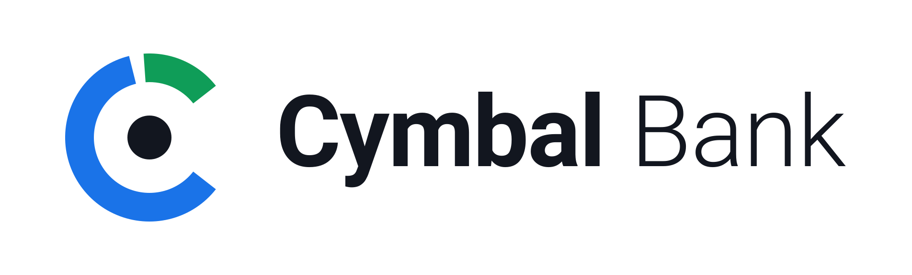
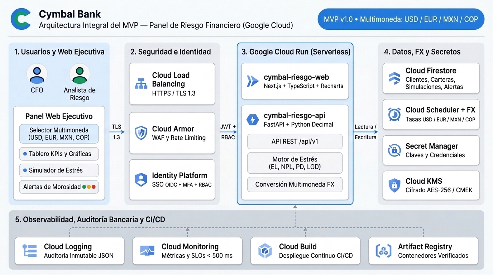
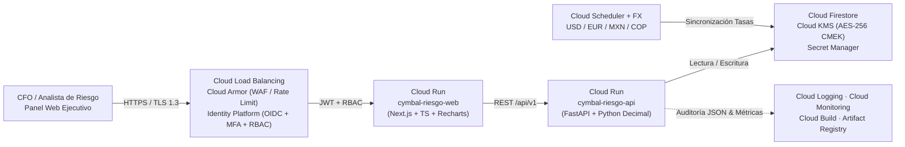

<p align="left">
  <picture>
    <source media="(prefers-color-scheme: dark)" srcset="assets/logos/cymbal-bank-logo-modo-oscuro.png">
    <source media="(prefers-color-scheme: light)" srcset="assets/logos/cymbal-bank-logo-principal-claro.png">
    
  </picture>
</p>

# Demo — Cymbal Bank: Panel de Riesgo Financiero


**Repositorio oficial de arquitectura, identidad de marca y desarrollo del MVP del Panel Ejecutivo de Riesgo Financiero de Cymbal Bank (División de Banca Corporativa y Gestión de Riesgos).**

---

## Tabla de Contenidos

1. [Resumen Ejecutivo](#1-resumen-ejecutivo)
2. [Arquitectura Integral del MVP en Google Cloud](#2-arquitectura-integral-del-mvp-en-google-cloud)
3. [Stack Tecnológico Oficial](#3-stack-tecnológico-oficial)
4. [Motor de Riesgo Financiero y Modelo Multimoneda](#4-motor-de-riesgo-financiero-y-modelo-multimoneda)
5. [Seguridad, Identidad (RBAC) y Auditoría Bancaria](#5-seguridad-identidad-rbac-y-auditoría-bancaria)
6. [Sistema de Diseño e Identidad de Marca](#6-sistema-de-diseño-e-identidad-de-marca)
7. [Estructura del Repositorio](#7-estructura-del-repositorio)
8. [Hoja de Ruta del MVP](#8-hoja-de-ruta-del-mvp)
9. [Flujo de Trabajo en Git y Sincronización](#9-flujo-de-trabajo-en-git-y-sincronización)
10. [Documentación y Recursos Oficiales](#10-documentación-y-recursos-oficiales)

---

## 1. Resumen Ejecutivo

El **Panel de Riesgo Financiero de Cymbal Bank** ofrece a Directores Financieros (**CFO**) y **Analistas de Riesgo** visibilidad consolidada y accionable sobre la exposición crediticia, la morosidad de cartera y el impacto patrimonial bajo escenarios de estrés macroeconómico.

### Propuesta de Valor del MVP v1.0

- **Toma de decisiones con precisión contable:** Todos los cálculos de riesgo (`EL`, `NPL`, `PD`, `LGD`) y conversiones cambiarias se ejecutan en servidor mediante `Python Decimal`, eliminando imprecisiones de punto flotante binario.
- **Operación multimoneda nativa (`USD`, `EUR`, `MXN`, `COP`):** Conversión consistente respaldada por actualizaciones programadas de tasas FX con trazabilidad histórica.
- **Seguridad bancaria y cumplimiento por diseño:** Perímetro protegido con `TLS 1.3`, WAF (`Cloud Armor`), federación `SSO OIDC + MFA + RBAC` (`Identity Platform`), cifrado `AES-256 / CMEK` (`Cloud KMS`) y auditoría inmutable en formato JSON (`Cloud Logging`).
- **Arquitectura serverless de alto desempeño:** Servicios desacoplados en `Google Cloud Run` (`cymbal-riesgo-web` y `cymbal-riesgo-api`) diseñados para operar con objetivos de latencia **SLO `< 500 ms`**.
- **Gobernanza visual estricta:** Interfaz alineada al 100% con la Guía de Marca y la Guía de Logos de Cymbal Bank, cumpliendo contraste **WCAG AA** y números tabulares obligatorios (`tabular-nums`).

---

## 2. Arquitectura Integral del MVP en Google Cloud

El sistema se organiza en **cinco capas desacopladas** sobre Google Cloud Platform. Para la especificación técnica completa, consulte [`docs/architecture/ARQUITECTURA_MVP.md`](docs/architecture/ARQUITECTURA_MVP.md).



### Flujo de Solicitudes de Extremo a Extremo



### Resumen de Capas y Servicios

| Capa | Componentes en Google Cloud | Responsabilidad |
| :--- | :--- | :--- |
| **1. Usuarios y Web Ejecutiva** | Panel Web Ejecutivo (`CFO` y `Analista de Riesgo`) | Selector multimoneda (`USD/EUR/MXN/COP`), tablero de KPIs y gráficas, simulador de estrés y alertas de morosidad. |
| **2. Seguridad e Identidad** | Cloud Load Balancing, Cloud Armor, Identity Platform | Cifrado en tránsito `HTTPS / TLS 1.3`, protección `WAF + Rate Limiting` y autenticación `SSO OIDC + MFA + RBAC` con tokens `JWT`. |
| **3. Cómputo Serverless** | Cloud Run (`cymbal-riesgo-web`, `cymbal-riesgo-api`) | Frontend ejecutivo en Next.js/TypeScript/Recharts y backend financiero en FastAPI/Python `Decimal` (`/api/v1`, Motor de Estrés y FX). |
| **4. Datos, FX y Secretos** | Cloud Firestore, Cloud Scheduler + FX, Secret Manager, Cloud KMS | Persistencia de clientes, carteras, simulaciones y alertas; actualización programada FX; secretos centralizados y cifrado `AES-256 / CMEK`. |
| **5. Observabilidad y CI/CD** | Cloud Logging, Cloud Monitoring, Cloud Build, Artifact Registry | Auditoría bancaria inmutable en JSON, métricas y `SLOs < 500 ms`, despliegue continuo CI/CD y contenedores verificados. |

---

## 3. Stack Tecnológico Oficial

| Dominio | Tecnología | Justificación Técnica |
| :--- | :--- | :--- |
| **Frontend (`cymbal-riesgo-web`)** | Next.js + TypeScript + Recharts | Tipado estricto, renderizado ágil, gráficas financieras interactivas y control exacto de estilos WCAG AA. |
| **Backend (`cymbal-riesgo-api`)** | FastAPI + Python `Decimal` + Pydantic v2 | Alto rendimiento asíncrono, contratos OpenAPI automáticos y aritmética decimal exacta para métricas bancarias. |
| **Base de Datos** | Cloud Firestore | Esquema documental flexible y baja latencia para `clientes`, `carteras`, `simulaciones`, `alertas` y snapshots `fx_rates`. |
| **Cómputo** | Google Cloud Run (Serverless) | Escalamiento automático por demanda, cero administración de infraestructura y despliegue basado en contenedores OCI. |
| **Automatización FX** | Cloud Scheduler | Ejecución determinística y programada de ingesta de tasas de cambio `USD / EUR / MXN / COP`. |
| **Seguridad y Cifrado** | Cloud Armor, Identity Platform, Secret Manager, Cloud KMS | Defensa en profundidad: perímetro WAF, federación OIDC/MFA/RBAC, gestión de secretos y cifrado CMEK `AES-256`. |
| **CI/CD y Observabilidad** | Cloud Build, Artifact Registry, Cloud Logging, Cloud Monitoring | Pipeline automatizado con contenedores verificados, auditoría JSON inmutable y monitoreo de SLOs `< 500 ms`. |

---

## 4. Motor de Riesgo Financiero y Modelo Multimoneda

El servicio `cymbal-riesgo-api` centraliza toda la lógica cuantitativa para garantizar consistencia entre el tablero ejecutivo, los reportes y los registros de auditoría:

- **Pérdida Esperada (`EL`):** Calculada por operación, segmento y cartera consolidada como `EL = PD × LGD × EAD`.
- **Índice de Morosidad (`NPL`):** Proporción de exposición en cartera vencida sobre la exposición total de la cartera.
- **Simulador de Estrés:** Permite aplicar choques sobre `PD`, `LGD` y tipos de cambio FX, persistiendo cada simulación en Firestore con su snapshot de tasas para auditoría y comparación histórica.
- **Precisión Financiera Obligatoria:**
  - Uso exclusivo de `decimal.Decimal` en Python (sin `float` IEEE 754).
  - Redondeo bancario (`ROUND_HALF_EVEN`) con divisas ISO 4217 explícitas (`USD`, `EUR`, `MXN`, `COP`).
- **Actualización FX:** `Cloud Scheduler` alimenta periódicamente las tasas oficiales en Firestore conservando marcas de tiempo UTC.

---

## 5. Seguridad, Identidad (RBAC) y Auditoría Bancaria

| Control | Mecanismo Implementado | Estándar / Objetivo |
| :--- | :--- | :--- |
| **Cifrado en tránsito** | Cloud Load Balancing | `HTTPS / TLS 1.3` obligatorio de extremo a extremo. |
| **Protección perimetral** | Cloud Armor | Reglas WAF (OWASP) y `Rate Limiting` en endpoints críticos. |
| **Autenticación y acceso** | Identity Platform | `SSO OIDC` corporativo + `MFA` obligatorio + emisión `JWT` con claims `RBAC`. |
| **Autorización por rol** | Middleware `cymbal-riesgo-api` | Separación de permisos entre `CFO` (supervisión/lectura ejecutiva) y `Analista de Riesgo` (simulación y gestión de alertas). |
| **Cifrado en reposo** | Cloud KMS (`CMEK`) | `AES-256` con claves gestionadas por el cliente y rotación periódica. |
| **Gestión de credenciales** | Secret Manager | Cero secretos en código fuente o historial Git; acceso IAM de mínimo privilegio. |
| **Trazabilidad regulatoria** | Cloud Logging | Auditoría inmutable en formato JSON con usuario, rol, acción, moneda, parámetros y timestamp. |
| **Confiabilidad operativa** | Cloud Monitoring | Métricas en tiempo real y cumplimiento de `SLOs < 500 ms` (p95). |

---

## 6. Sistema de Diseño e Identidad de Marca

Todo componente del panel web, gráfica, correo o reporte debe adherirse estrictamente a la [**Guía de Marca**](docs/brand/GUIA_DE_MARCA.md) y a la [**Guía de Logos**](docs/brand/GUIA_DE_LOGOS.md) oficiales de Cymbal Bank.

### Paleta Cromática Oficial

| Rol / Token | Código Hex | Uso Institucional |
| :--- | :---: | :--- |
| **Primario** | `#1A73E8` | Acciones principales, encabezados, enlaces y series primarias en gráficas. |
| **Secundario** | `#0F9D58` | Indicadores positivos, métricas en rango y semáforo de **Riesgo Bajo**. |
| **Riesgo Medio** | `#F9AB00` | Alertas preventivas, vigilancia activa y desviaciones moderadas (usar con texto `#12161F`). |
| **Riesgo Alto** | `#D93025` | Alertas críticas, incumplimientos de umbral y deterioro de cartera (prohibido como adorno). |
| **Fondo Claro** | `#F8F9FA` | Superficie base diurna, tarjetas, reportes y presentaciones ejecutivas. |
| **Fondo Oscuro** | `#12161F` | Modo oscuro de consolas de riesgo, encabezados institucionales y portadas ejecutivas. |

### Reglas Tipográficas y de Logotipo

- **Tipografía:** `Inter` (preferida en aplicaciones web) y `Roboto` (alternativa oficial en documentos y presentaciones).
- **Números tabulares obligatorios:** Todas las métricas monetarias, porcentajes y columnas numéricas deben aplicar `font-variant-numeric: tabular-nums; font-feature-settings: "tnum" 1;` con alineación a la derecha y moneda explícita (ej. `USD 14,250,000.00`).
- **Activos de marca:** Utilizar exclusivamente los archivos oficiales `SVG` y `PNG` versionados en [`assets/logos/`](assets/logos/). Jamás aplicar `#D93025` ni `#F9AB00` sobre el logotipo.
- **Tono ejecutivo:** Comunicación sobria, cuantitativa y orientada a decisión para CFO (conclusión primero; sin hipérboles ni emojis decorativos en interfaces o informes formales).

---

## 7. Estructura del Repositorio

```text
.
├── README.md                                       # Documentación maestra del proyecto
├── docker-compose.yml                              # Orquestación local full-stack (API + Web)
├── .gitignore                                      # Exclusiones para Next.js, Python, GCP y secretos
├── apps/
│   ├── api/                                        # Servicio Cloud Run: cymbal-riesgo-api (FastAPI + Python Decimal)
│   │   ├── Dockerfile                              # Contenedor OCI de producción (no-root, puerto 8080)
│   │   ├── pyproject.toml                          # Dependencias y configuración de pytest
│   │   ├── app/
│   │   │   ├── main.py                             # App FastAPI, CORS y middleware SLO (< 500 ms)
│   │   │   ├── config.py                           # Configuración tipada (memory / firestore)
│   │   │   ├── api/v1/routes.py                    # Endpoints REST /api/v1 (cartera, clientes, FX, estrés, alertas, auditoría)
│   │   │   ├── domain/                             # Modelos Decimal, conversor FX y motor de estrés (EL/NPL/PD/LGD)
│   │   │   ├── repositories/                       # Interfaz, semilla corporativa, memoria local y adaptador Cloud Firestore
│   │   │   ├── security/auth.py                    # Identidad JWT/OIDC y control RBAC (CFO vs Analista de Riesgo)
│   │   │   └── observability/audit.py              # Auditoría bancaria inmutable en JSON (Cloud Logging)
│   │   └── tests/                                  # Suite pytest (precisión Decimal, FX, estrés, RBAC y SLO)
│   └── web/                                        # Servicio Cloud Run: cymbal-riesgo-web (Next.js + TS + Recharts)
│       ├── Dockerfile                              # Contenedor standalone Next.js (no-root, puerto 8080)
│       ├── next.config.ts                          # Proxy interno /api/v1 y salida standalone
│       ├── public/logos/                           # Activos oficiales de logotipo Cymbal Bank
│       └── src/
│           ├── app/                                # Layout (Inter/Roboto), sistema de diseño CSS y página principal
│           ├── components/                         # TopBar, Resumen Ejecutivo, Cartera, Simulador, Alertas y Auditoría/FX
│           ├── lib/                                # Cliente API tipado y formateadores tabulares ISO 4217
│           └── types/                              # Contratos TypeScript alineados con /api/v1
├── infra/
│   ├── cloudbuild/cloudbuild.yaml                  # Pipeline CI/CD (pytest, Next build, Artifact Registry y Cloud Run)
│   └── terraform/                                  # Blueprint IaC GCP (Cloud Run, Firestore, KMS CMEK, Armor, Scheduler)
├── docs/
│   ├── architecture/
│   │   ├── ARQUITECTURA_MVP.md                     # Especificación técnica detallada de las 5 capas
│   │   └── arquitectura-mvp-cymbal-bank.jpg        # Diagrama oficial de arquitectura del MVP v1.0
│   └── brand/
│       ├── GUIA_DE_MARCA.md                        # Estándar de identidad visual, paleta, tipografía y tono CFO
│       └── GUIA_DE_LOGOS.md                        # Manual de logotipo, isotipo, retícula y usos aprobados
├── assets/
│   ├── logos/                                      # 6 variantes oficiales en formato vectorial SVG y PNG
│   └── brand-boards/                               # 4 láminas técnicas de marca (construcción, variantes y restricciones)
└── scripts/
    └── generate_cymbal_logos.py                    # Generador reproducible de activos vectoriales y láminas PNG
```

### Ejecución Local y Pruebas

#### 1. Backend financiero (`cymbal-riesgo-api`)

```bash
cd apps/api
uv venv .venv && uv pip install --python .venv/bin/python -e ".[dev]"
.venv/bin/pytest -v
.venv/bin/uvicorn app.main:app --host 127.0.0.1 --port 8000 --reload
```

#### 2. Panel Web Ejecutivo (`cymbal-riesgo-web`)

```bash
cd apps/web
npm install
npm run lint && npm run build
npm run dev
```

Con ambos servicios activos, el panel web consume `/api/v1/*` mediante proxy interno de Next.js hacia `http://127.0.0.1:8000` (configurable con `API_INTERNAL_URL`). También puede levantarse el entorno completo con `docker compose up --build`.

---

## 8. Hoja de Ruta del MVP

| Fase | Alcance Principal | Estado |
| :--- | :--- | :---: |
| **Fase 0 — Identidad y Gobernanza de Marca** | Guía de Marca, Guía de Logos, paleta oficial, activos SVG/PNG y láminas de uso. | Completada |
| **Fase 1 — Arquitectura MVP y Repositorio Git** | Diagrama integral de 5 capas en Google Cloud, especificación técnica y sincronización inicial en GitHub. | Completada |
| **Fase 2 — Backend Financiero (`cymbal-riesgo-api`)** | API REST `/api/v1` en FastAPI, Motor de Estrés (`EL`, `NPL`, `PD`, `LGD`) con `Python Decimal`, módulo FX, RBAC, auditoría JSON y 13 pruebas `pytest`. | Completada |
| **Fase 3 — Panel Web Ejecutivo (`cymbal-riesgo-web`)** | Interfaz Next.js + TypeScript + Recharts + CSS oficial (Claro/Oscuro) con selector multimoneda (`USD/EUR/MXN/COP`), tablero KPIs, simulador, alertas y visor de auditoría. | Completada |
| **Fase 4 — Datos, Seguridad y Despliegue GCP** | Adaptador `Cloud Firestore`, Dockerfiles Cloud Run, pipeline `Cloud Build` y blueprint `Terraform` (KMS CMEK, Secret Manager, Cloud Armor, Scheduler). Pendiente aprovisionamiento en proyecto GCP destino. | En progreso (IaC listo) |

---

## 9. Flujo de Trabajo en Git y Sincronización

Este repositorio funciona como fuente única de verdad para sincronizar arquitectura, activos de diseño y código fuente del proyecto:

1. **Clonar el repositorio:**
   ```bash
   git clone https://github.com/gomezgarciam/demo-cymbal-bank-panel-de-riesgo-financiero.git
   cd demo-cymbal-bank-panel-de-riesgo-financiero
   ```
2. **Trabajar siempre en ramas descriptivas:**
   ```bash
   git checkout -b feat/cymbal-riesgo-api
   ```
   Prefijos recomendados: `feat/`, `fix/`, `docs/`, `infra/`, `chore/`.
3. **Reglas de calidad y seguridad:**
   - Nunca confirmar archivos `.env`, llaves privadas ni credenciales JSON de Google Cloud (usar `Secret Manager`).
   - Toda modificación de interfaz debe validar cumplimiento de paleta, contraste WCAG AA y `tabular-nums`.
   - Toda lógica financiera debe incluir pruebas automatizadas que verifiquen exactitud con `decimal.Decimal`.
4. **Regeneración opcional de activos de logotipo (requiere `rsvg-convert` / `librsvg`):**
   ```bash
   python3 scripts/generate_cymbal_logos.py
   ```

---

## 10. Documentación y Recursos Oficiales

### Documentación Versionada en el Repositorio

- [Arquitectura Integral del MVP (`ARQUITECTURA_MVP.md`)](docs/architecture/ARQUITECTURA_MVP.md)
- [Diagrama de Arquitectura MVP v1.0 (`arquitectura-mvp-cymbal-bank.jpg`)](docs/architecture/arquitectura-mvp-cymbal-bank.jpg)
- [Guía de Marca — Cymbal Bank (`GUIA_DE_MARCA.md`)](docs/brand/GUIA_DE_MARCA.md)
- [Guía de Logos — Cymbal Bank (`GUIA_DE_LOGOS.md`)](docs/brand/GUIA_DE_LOGOS.md)

### Fuentes Maestras en Google Drive (Kit de Diseño)

- [Carpeta Kit de Diseño — Cymbal Bank](https://drive.google.com/drive/folders/1DMpr7CM3_KN6tAOxEwsUFH0ZO-vnFT3k)
- [Guía de Marca — Cymbal Bank (Google Doc)](https://docs.google.com/document/d/1ER4OtSPleHdrR3RNfLFFjhFzPdpBVK73MDoQVxlYLT8/edit)
- [Guía de Logos — Cymbal Bank (Google Doc)](https://docs.google.com/document/d/1yYHgcb4tZS7dVTZnwPYGVX4e92rekuAjAIVcZ0FU5N0/edit)
- [Carpeta Logos Oficiales SVG/PNG — Cymbal Bank](https://drive.google.com/drive/folders/1OKOu1nIJGoIwzzSoQhrQFve44slT-s9k)

---

*Cymbal Bank — Banca Corporativa y Gestión de Riesgos · Panel de Riesgo Financiero (MVP v1.0)*
