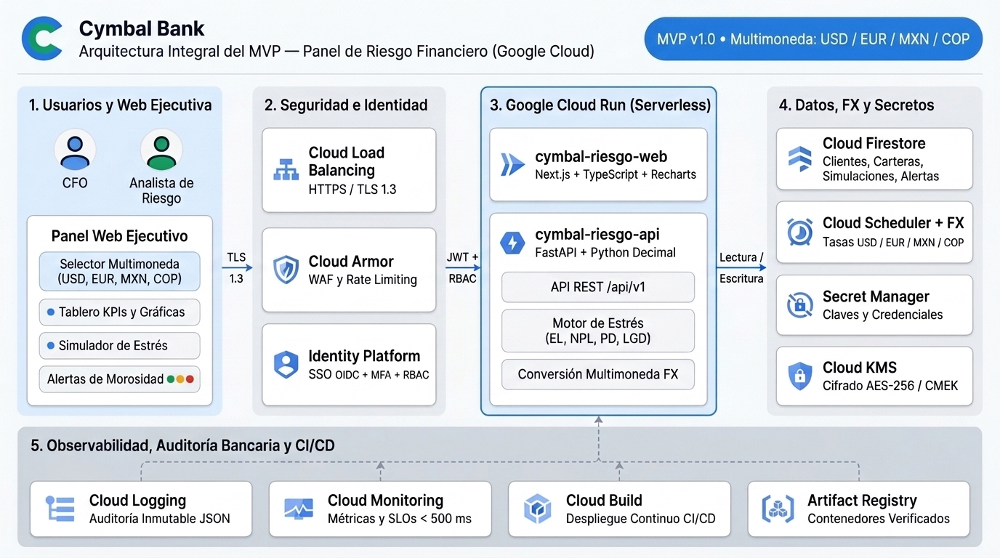
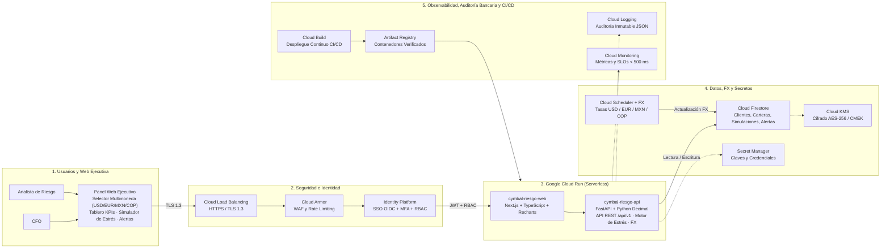

# Arquitectura Integral del MVP — Panel de Riesgo Financiero (Google Cloud)

- **Organización:** Cymbal Bank — Banca Corporativa y Gestión de Riesgos
- **Versión de arquitectura:** `MVP v1.0`
- **Cobertura multimoneda:** `USD` · `EUR` · `MXN` · `COP`
- **Objetivo de latencia (SLO):** `< 500 ms` (p95 en consultas de cartera y simulaciones estándar)
- **Identidad visual aplicable:** [Guía de Marca](../brand/GUIA_DE_MARCA.md) y [Guía de Logos](../brand/GUIA_DE_LOGOS.md)

---

## 1. Diagrama Oficial de Arquitectura



### Flujo de Componentes (Mermaid)



---

## 2. Diseño Detallado por Capas

### Capa 1 — Usuarios y Panel Web Ejecutivo

Orientada a decisiones rápidas de alta dirección bajo el principio de conclusión primero:

| Perfil | Responsabilidad Principal | Módulos Habilitados |
| :--- | :--- | :--- |
| **CFO** | Supervisión ejecutiva de capital, exposición agregada, morosidad crítica y revisión de escenarios de estrés aprobados. | Selector multimoneda, Tablero KPIs y Gráficas, Alertas de Morosidad, lectura de simulaciones y exportación ejecutiva. |
| **Analista de Riesgo** | Modelado de escenarios de estrés crediticio, calibración de choques macroeconómicos (`PD`, `LGD`), triage de alertas de morosidad y auditoría de cartera. | Todos los módulos del panel, ejecución y persistencia de escenarios en el Simulador de Estrés, gestión de estados de alertas. |

**Capacidades clave del Panel Web Ejecutivo:**
- **Selector Multimoneda (`USD`, `EUR`, `MXN`, `COP`):** Recalcula de forma determinística todos los KPIs, series temporales y tablas manteniendo moneda explícita y alineación con `tabular-nums`.
- **Tablero KPIs y Gráficas:** Exposición total (`EAD`), pérdida esperada (`EL`), índice de cartera vencida (`NPL`), distribución por segmento/sector y evolución histórica.
- **Simulador de Estrés:** Aplicación interactiva de choques sobre `PD`, `LGD` y tasas FX con comparación inmediata frente a la línea base.
- **Alertas de Morosidad:** Semaforización normativa estricta:
  - **Riesgo Bajo / En rango:** `#0F9D58`
  - **Riesgo Medio / Vigilancia:** `#F9AB00`
  - **Riesgo Alto / Umbral crítico superado:** `#D93025`

---

### Capa 2 — Seguridad Perimetral e Identidad

Toda petición externa atraviesa un perímetro defensivo endurecido antes de llegar a los servicios de cómputo:

- **Cloud Load Balancing (`HTTPS / TLS 1.3`):** Terminación TLS moderna con política SSL restrictiva (sin protocolos heredados) y redirección obligatoria de HTTP a HTTPS.
- **Cloud Armor (`WAF y Rate Limiting`):** Reglas OWASP Top 10 administradas, protección DDoS en borde y límites de frecuencia por IP/sesión para endpoints de simulación y autenticación.
- **Identity Platform (`SSO OIDC + MFA + RBAC`):** Autenticación federada corporativa vía OpenID Connect, autenticación multifactor obligatoria y emisión de tokens JWT firmados con reclamos de rol (`role: cfo | risk_analyst`).
- **Propagación `JWT + RBAC`:** El servicio `cymbal-riesgo-api` valida criptográficamente cada token JWT en cada petición y aplica control de acceso basado en roles a nivel de endpoint y operación.

---

### Capa 3 — Cómputo Serverless en Google Cloud Run

Arquitectura desacoplada en dos servicios contenerizados independientes, con autoescalado sin servidor y aislamiento de responsabilidades:

#### 1. `cymbal-riesgo-web` (Frontend Ejecutivo)
- **Tecnologías:** Next.js (App Router) + TypeScript + Recharts.
- **Diseño y cumplimiento visual:** Estándar oficial de Cymbal Bank (Fondo Claro `#F8F9FA`, soporte Fondo Oscuro `#12161F`, Primario `#1A73E8`, Secundario `#0F9D58`, tipografía `Inter`/`Roboto` con `font-variant-numeric: tabular-nums`).
- **Comunicación:** Consume exclusivamente la API versionada `/api/v1` adjuntando el token JWT de sesión.

#### 2. `cymbal-riesgo-api` (Backend Financiero)
- **Tecnologías:** FastAPI + Python con aritmética exacta mediante `decimal.Decimal` (prohibido el uso de `float` binario IEEE 754 para montos monetarios, tasas o pérdidas esperadas).
- **Subcomponentes internos:**
  - **API REST `/api/v1`:** Contratos tipados con Pydantic v2, validación estricta de divisas (`USD`, `EUR`, `MXN`, `COP`), OpenAPI documentado y códigos de error estandarizados.
  - **Motor de Estrés (`EL`, `NPL`, `PD`, `LGD`):** Evaluación determinística de métricas de riesgo de crédito bajo escenario base y escenarios estresados.
  - **Conversión Multimoneda FX:** Conversión exacta usando tasas vigentes o históricas con redondeo bancario (`ROUND_HALF_EVEN`) y metadato explícito de tipo de cambio aplicado (`fx_rate`, `fx_timestamp`).

---

### Capa 4 — Datos, Tasas FX y Secretos

- **Cloud Firestore:** Base de datos documental serverless con lectura/escritura de baja latencia organizada en cuatro colecciones nucleares (más catálogo FX):
  - `clientes`: entidades corporativas, sector económico, calificación crediticia, país y moneda base.
  - `carteras`: exposiciones activas (`EAD`), días de mora, `PD`, `LGD`, estado de cartera y moneda de origen.
  - `simulaciones`: histórico auditable de pruebas de estrés (parámetros de choque, moneda de reporte, snapshot FX, `EL`/`NPL` resultante, usuario y timestamp).
  - `alertas`: eventos de superación de umbrales de morosidad o concentración con severidad (`BAJO`, `MEDIO`, `ALTO`) y trazabilidad de atención.
  - `fx_rates`: histórico de tasas oficiales `USD / EUR / MXN / COP` con marca de tiempo UTC.
- **Cloud Scheduler + FX:** Tarea programada periódica que ingesta y actualiza las tasas de cambio `USD / EUR / MXN / COP` en Firestore, conservando respaldo histórico para reproducibilidad de reportes pasados.
- **Secret Manager:** Almacenamiento versionado de llaves de API FX, configuración OIDC y credenciales internas con acceso restringido mediante IAM de mínimo privilegio (sin secretos en código ni en Git).
- **Cloud KMS (`AES-256 / CMEK`):** Cifrado en reposo gestionado por el cliente para Firestore, artefactos de despliegue y buckets de auditoría, con rotación automática de claves.

---

### Capa 5 — Observabilidad, Auditoría Bancaria y CI/CD

- **Cloud Logging (`Auditoría Inmutable JSON`):** Logs estructurados en JSON para cada consulta sensible, cálculo de estrés, cambio de estado de alerta o fallo de autorización; enrutables a sinks con políticas de retención bloqueada (WORM) para cumplimiento bancario.
- **Cloud Monitoring (`Métricas y SLOs < 500 ms`):** Seguimiento continuo de latencia p50/p95/p99, tasa de error (`5xx`/`4xx`), disponibilidad de Cloud Run y alertas proactivas ante consumo acelerado del *error budget*.
- **Cloud Build (`Despliegue Continuo CI/CD`):** Pipelines automatizados activados desde GitHub para ejecutar linters, pruebas unitarias (incluyendo precisión `Decimal`), construcción de imágenes Docker y despliegue progresivo en Cloud Run.
- **Artifact Registry (`Contenedores Verificados`):** Almacenamiento privado de imágenes OCI con escaneo automático de vulnerabilidades antes de promoción a producción.

---

## 3. Reglas del Motor Financiero y Precisión Numérica

### Fórmulas Base del Motor de Estrés

- **Pérdida Esperada (`EL`):**
  $$EL = PD \times LGD \times EAD$$
  donde `PD` es la probabilidad de incumplimiento (`0 <= PD <= 1`), `LGD` es la severidad de la pérdida dado el incumplimiento (`0 <= LGD <= 1`) y `EAD` es la exposición al momento del incumplimiento en la moneda de reporte.

- **Índice de Morosidad (`NPL`):**
  $$NPL = \frac{\sum EAD_{\text{cartera vencida (> 90 días)}}}{\sum EAD_{\text{cartera total}}}$$

- **Precisión financiera en Python:**
  - Todos los cálculos monetarios usan `decimal.Decimal` inicializado desde cadenas (`Decimal("14250000.00")`), nunca desde `float`.
  - Redondeo bancario estandarizado (`ROUND_HALF_EVEN`) a 2 decimales para montos presentados y 6 decimales internos para tasas FX y factores `PD`/`LGD`.
  - Serialización JSON como cadenas numéricas exactas o valores normalizados acompañados siempre del código ISO 4217 (`USD`, `EUR`, `MXN`, `COP`).

---

## 4. Contratos de API Previstos (`/api/v1`)

| Método | Ruta | Rol Permitido | Descripción |
| :---: | :--- | :--- | :--- |
| `GET` | `/api/v1/health` | Público (interno LB) | Verificación de estado del servicio y conectividad. |
| `GET` | `/api/v1/portfolio/summary?currency=USD` | `CFO`, `Analista de Riesgo` | KPIs consolidados (`EAD`, `EL`, `NPL`, distribución sectorial) en la divisa solicitada. |
| `GET` | `/api/v1/clients` | `CFO`, `Analista de Riesgo` | Listado paginado de clientes corporativos y exposición por cartera. |
| `GET` | `/api/v1/fx/rates` | `CFO`, `Analista de Riesgo` | Tasas vigentes `USD / EUR / MXN / COP` con timestamp de actualización. |
| `POST` | `/api/v1/stress-tests` | `Analista de Riesgo` | Ejecuta y persiste una simulación de estrés (`PD`, `LGD`, choque FX) devolviendo impacto en `EL` y `NPL`. |
| `GET` | `/api/v1/stress-tests` | `CFO`, `Analista de Riesgo` | Consulta historial auditable de simulaciones ejecutadas. |
| `GET` | `/api/v1/alerts` | `CFO`, `Analista de Riesgo` | Alertas activas de morosidad clasificadas por severidad semafórica. |
| `PATCH` | `/api/v1/alerts/{alert_id}` | `Analista de Riesgo` | Actualiza estado de atención de una alerta dejando registro de auditoría JSON. |

---

## 5. Topología Objetivo del Monorepo

A medida que se implemente el MVP sobre este repositorio sincronizado con GitHub, se seguirá la siguiente estructura:

```text
demo-cymbal-bank-panel-de-riesgo-financiero/
├── apps/
│   ├── web/                    # Servicio Cloud Run: cymbal-riesgo-web (Next.js + TS + Recharts)
│   └── api/                    # Servicio Cloud Run: cymbal-riesgo-api (FastAPI + Python Decimal)
├── infra/
│   ├── cloudbuild/             # Pipelines CI/CD para Cloud Build + Artifact Registry
│   └── terraform/              # IaC: Cloud Run, Firestore, KMS (CMEK), Armor, Scheduler, IAM
├── docs/
│   ├── architecture/           # Diagramas y especificaciones técnicas del MVP
│   └── brand/                  # Guías normativas de marca y logotipos
├── assets/
│   ├── logos/                  # Activos oficiales SVG y PNG de Cymbal Bank
│   └── brand-boards/           # Láminas de construcción, variantes y usos prohibidos
└── scripts/                    # Utilidades de automatización y generación de activos
```
