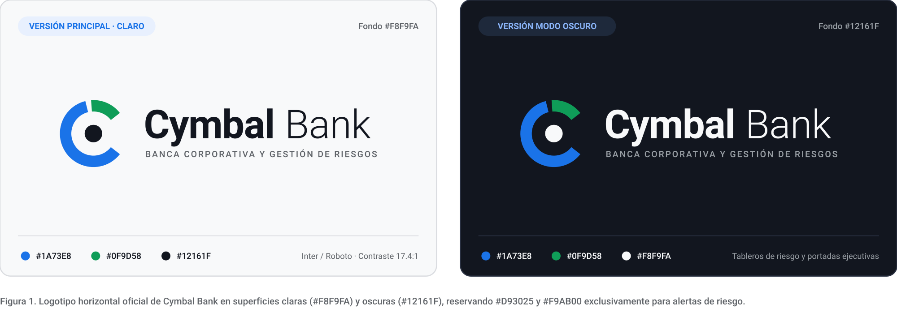
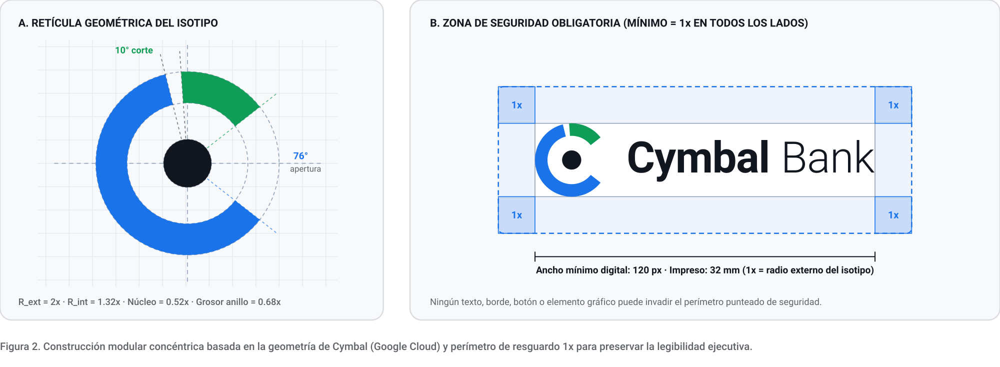
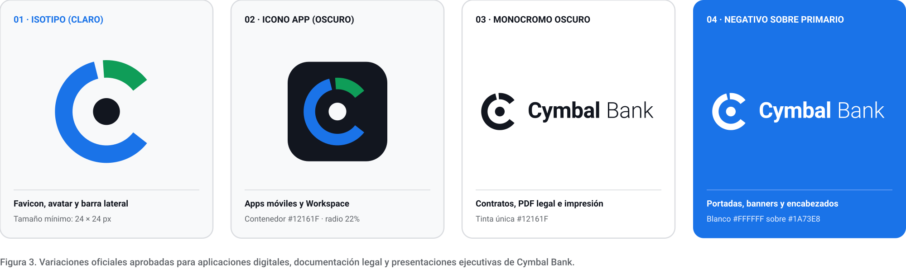
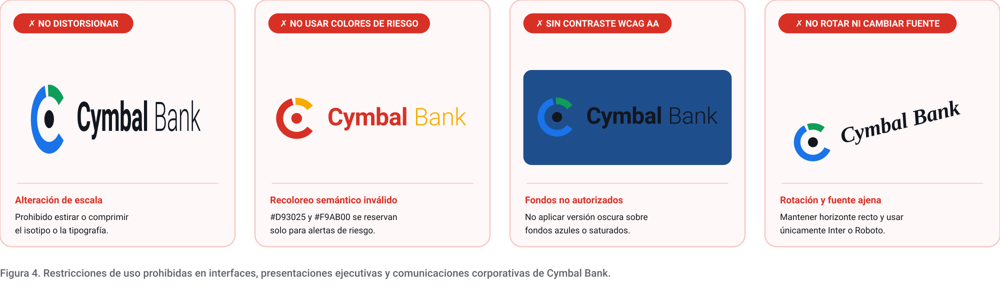

# Guía de Logos — Cymbal Bank

*Estándar Oficial de Logotipo, Isotipo, Construcción Geométrica y Aplicaciones Institucionales*

- **Marca:** Cymbal Bank
- **Referencia de marca:** [Guía de Marca — Cymbal Bank](GUIA_DE_MARCA.md) ([Google Doc](https://docs.google.com/document/d/1ER4OtSPleHdrR3RNfLFFjhFzPdpBVK73MDoQVxlYLT8/edit))
- **Fuente oficial en Google Drive:** [Guía de Logos - Cymbal Bank](https://docs.google.com/document/d/1yYHgcb4tZS7dVTZnwPYGVX4e92rekuAjAIVcZ0FU5N0/edit) · [Logos - Cymbal Bank](https://drive.google.com/drive/folders/1OKOu1nIJGoIwzzSoQhrQFve44slT-s9k)
- **Activos locales sincronizados:** [`assets/logos/`](../../assets/logos/) y [`assets/brand-boards/`](../../assets/brand-boards/)

> **Alcance Normativo:** Esta guía regula la reproducción exacta del logotipo e isotipo de Cymbal Bank en interfaces digitales, tableros de gestión de riesgos, presentaciones ejecutivas y correos dirigidos a directores financieros (CFO). Solo deben emplearse los archivos vectoriales (SVG) y de alta resolución (PNG) oficiales del Kit de Diseño.

---

## 1. Concepto y Estética de Marca (ADN Cymbal / Google)

El logotipo de Cymbal Bank traduce la arquitectura geométrica modular del ecosistema Cymbal de Google Cloud al rigor fiduciario de la Banca Corporativa y la Gestión de Riesgos. El isotipo sintetiza una letra "C" arquitectónica y la geometría concéntrica de un platillo (*cymbal*) mediante tres formas puras:

- Un arco estructural principal en **Primario (`#1A73E8`)** que representa solidez institucional.
- Un segmento superior ascendente en **Secundario (`#0F9D58`)** que simboliza crecimiento patrimonial y control de riesgo.
- Un núcleo central sólido en **Fondo Oscuro (`#12161F`)** o **Fondo Claro (`#F8F9FA`)** que ancla la precisión analítica.

La marca tipográfica adopta la jerarquía limpia característica de los productos de Google: **"Cymbal"** en peso Bold (`700`) combinado con **"Bank"** en peso Light (`300`) utilizando la familia Inter o Roboto. Los tonos **Riesgo Alto (`#D93025`)** y **Riesgo Medio (`#F9AB00`)** jamás forman parte del logotipo.

---

## 2. Construcción Geométrica, Zona de Seguridad y Tamaños Mínimos

El isotipo se construye sobre una retícula concéntrica exacta donde la unidad modular `x` equivale al radio interno de referencia (`R_ext = 2x`, `R_int = 1.32x`, núcleo central `= 0.52x`, grosor de anillo `= 0.68x`). La apertura lateral derecha de `76°` (`±38°` respecto al eje horizontal) y el corte estructural de `10°` entre el arco azul y el arco verde garantizan legibilidad nítida desde iconos de `24 px` hasta portadas de gran formato. Alrededor del logotipo completo debe respetarse siempre una **zona de seguridad mínima de `1x`** libre de textos, divisores o botones.

| Formato de Marca | Aplicación Principal | Mínimo Digital | Mínimo Impreso |
| :--- | :--- | :---: | :---: |
| **Logotipo Horizontal** | Barras de navegación, reportes CFO, correos y presentaciones. | `120 px` ancho | `32 mm` ancho |
| **Logotipo con Subtítulo** | Portadas ejecutivas, memorandos de riesgo y material institucional. | `200 px` ancho | `52 mm` ancho |
| **Isotipo Independiente** | Favicons, barras laterales colapsadas, avatares y sellos. | `24 × 24 px` | `8 × 8 mm` |
| **Icono de App (Oscuro)** | Aplicaciones móviles, accesos Google Workspace y PWA. | `32 × 32 px` | `10 × 10 mm` |

Cuando el espacio horizontal disponible sea inferior a `120 px`, se debe sustituir automáticamente el logotipo horizontal por el isotipo independiente.

---

## 3. Variaciones Aprobadas y Selección según Superficie

- **Principal sobre Fondo Claro (`#F8F9FA` o `#FFFFFF`):** Opción predeterminada para aplicaciones web diurnas, Google Docs, estados financieros y correos ejecutivos (contraste `17.4:1`).
- **Modo Oscuro sobre Fondo Oscuro (`#12161F`):** Obligatorio en consolas de gestión de riesgos, portadas oscuras y barras superiores oscuras; mantiene `#1A73E8` y `#0F9D58` invirtiendo núcleo y texto a `#F8F9FA`.
- **Monocromo Oscuro (`#12161F`) y Negativo Claro (`#FFFFFF` sobre `#1A73E8`):** La versión monocroma oscura se reserva para contratos, anexos de auditoría e impresión B/N; la negativa blanca aplica sobre superficies sólidas en `#1A73E8`.
- **Isotipo e Icono de Aplicación (`1:1`):** Emplear en espacios compactos, favicons y contenedores de apps sobre `#12161F` con radio de esquina proporcional al `22%`.

---

## 4. Usos Incorrectos y Restricciones de Cumplimiento

- **SÍ — Usar siempre activos vectoriales SVG en web y PNG 2x/4x en presentaciones:** Garantiza bordes nítidos en pantallas Retina.
- **SÍ — Alinear el logotipo a la retícula de encabezados y respetar `1x` de resguardo:** Mantener separación clara frente a métricas tabulares, selectores de divisa y badges de riesgo.
- **NO — Recolorear con `#D93025` o `#F9AB00` ni añadir degradados o sombras:** Los colores de riesgo están prohibidos en el logotipo.
- **NO — Deformar, rotar, recrear con otras fuentes ni colocar sobre fondos sin contraste:** Nunca sustituir Inter o Roboto ni incumplir WCAG AA.

---

## 5. Inventario Oficial de Activos

| Archivo Maestro (`SVG` y `PNG`) | Superficie Aprobada | Canal Recomendado |
| :--- | :--- | :--- |
| [`cymbal-bank-logo-principal-claro`](../../assets/logos/cymbal-bank-logo-principal-claro.svg) | Fondo Claro (`#F8F9FA`) / `#FFFFFF` | Apps web claras, correos, reportes y Docs. |
| [`cymbal-bank-logo-modo-oscuro`](../../assets/logos/cymbal-bank-logo-modo-oscuro.svg) | Fondo Oscuro (`#12161F`) | Tableros de riesgo y portadas oscuras. |
| [`cymbal-bank-logo-monocromo-oscuro`](../../assets/logos/cymbal-bank-logo-monocromo-oscuro.svg) | Papel / Fondo Claro (`#FFFFFF`) | Contratos, PDF legal y auditoría B/N. |
| [`cymbal-bank-logo-monocromo-claro`](../../assets/logos/cymbal-bank-logo-monocromo-claro.svg) | Primario (`#1A73E8`) / Oscuro | Banners corporativos y portadas azules. |
| [`cymbal-bank-isotipo`](../../assets/logos/cymbal-bank-isotipo.svg) | Fondo Claro (`#F8F9FA`) / Transparente | Favicons, avatares y barras compactas. |
| [`cymbal-bank-icono-app-oscuro`](../../assets/logos/cymbal-bank-icono-app-oscuro.svg) | Contenedor `#12161F` (`1:1`) | Apps móviles, PWA e iconos Workspace. |

Los activos pueden regenerarse de manera reproducible ejecutando [`scripts/generate_cymbal_logos.py`](../../scripts/generate_cymbal_logos.py).

---

*Cymbal Bank — Banca Corporativa y Gestión de Riesgos · Guía de Logos Oficial · Kit de Diseño*
